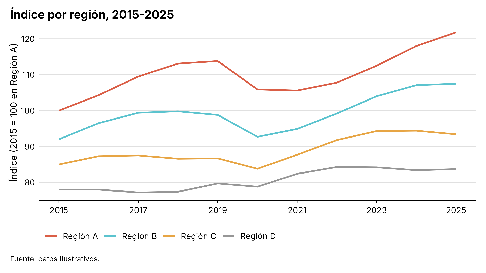
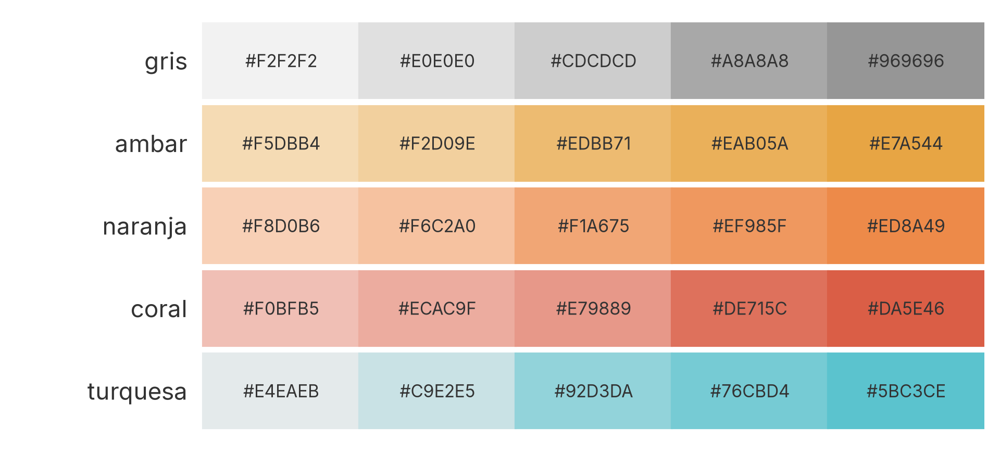
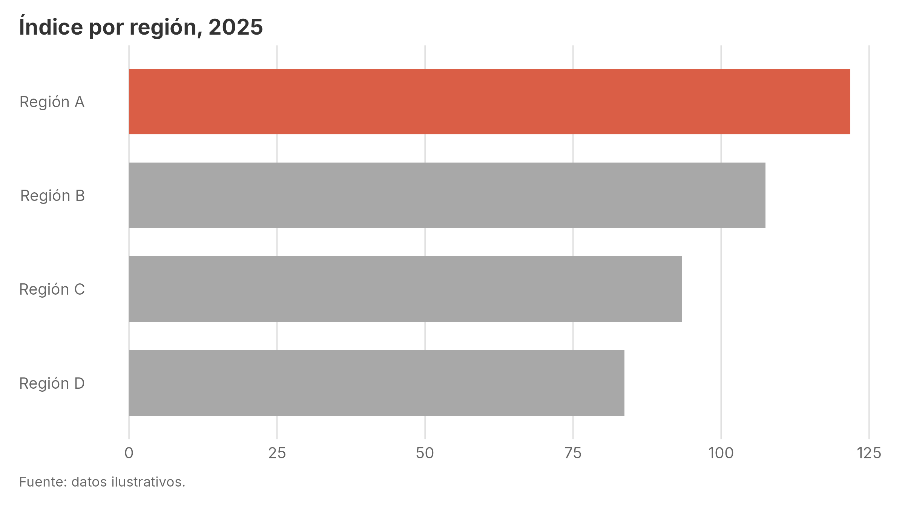
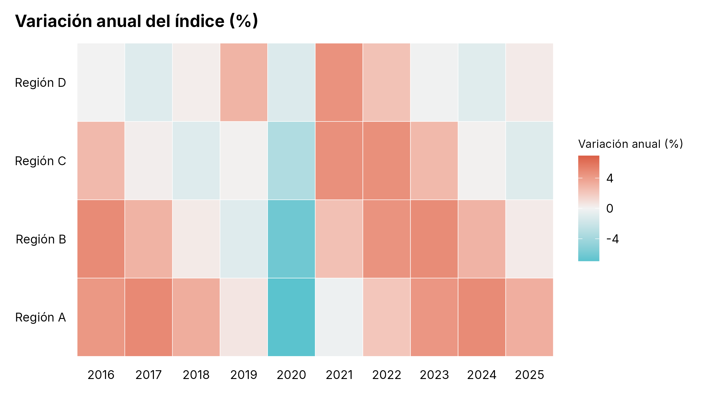

# Guía de R

**ggplot2** · [← Volver al inicio](../README.md)

Tres pasos: instalar una vez, activar el estilo en cada script y hacer la gráfica como siempre.

## Paso 1. Instalar (una sola vez por computador)

En la consola de R:

```r
install.packages("remotes")
remotes::install_github("fedesarrollo/graph-template", subdir = "R")
```

Esto instala también ggplot2 y la fuente Inter. **No hay que instalar nada más.**

> **¿Tenía instalada la versión anterior** (cuando se llamaba `estilograficas`)? Bórrela primero:
> ```r
> remove.packages("estilograficas")
> ```

## Paso 2. Activar el estilo (al inicio de cada script)

```r
library(fedesarrollo.estilo.graficas)   # también carga ggplot2
aplicar_estilo()
```

## Paso 3. Hacer la gráfica

Copie este ejemplo, córralo y use la gráfica como punto de partida:

```r
library(fedesarrollo.estilo.graficas)
aplicar_estilo()

datos <- data.frame(
  anio  = rep(2021:2025, 2),
  valor = c(100, 104, 109, 113, 118, 92, 96, 99, 100, 107),
  grupo = rep(c("Región A", "Región B"), each = 5)
)

g <- ggplot(datos, aes(anio, valor, color = grupo)) +
  geom_line() +
  labs(title = "Índice por región, 2021-2025", x = NULL, y = NULL,
       caption = "Fuente: datos ilustrativos.")

guardar_grafica(g, "mi_grafica")   # crea mi_grafica.png y mi_grafica.pdf
```

Los colores, la leyenda abajo y la fuente salen solos. Los colores van en orden: coral, turquesa, ámbar, gris.



## Antes de entregar una gráfica

- [ ] `library(estilograficas)` y `aplicar_estilo()` al inicio del script.
- [ ] Máximo **4 grupos** de color por gráfica (con más, ggplot da un error que lo explica).
- [ ] La fuente de los datos va en `caption` dentro de `labs()`.
- [ ] Guardar con `guardar_grafica()`, **no** con `ggsave()`.

## Recetas

### Resaltar un dato

```r
ggplot(df, aes(valor, reorder(grupo, valor), fill = valor == max(valor))) +
  geom_col() +
  scale_fill_manual(values = c(`FALSE` = paleta_color("gris", 4),
                               `TRUE`  = paleta_colores[["coral"]]),
                    guide = "none")
```

### Poner números o texto dentro de la gráfica

`geom_text()` y `geom_label()` salen en negro y con Inter:

```r
ggplot(df, aes(grupo, valor)) +
  geom_col() +
  geom_text(aes(label = round(valor, 1)), vjust = -0.5)
```

Con `annotate()`, agregue `family = paleta_fuente`.

### Mapas de calor y mapas

```r
ggplot(tabla, aes(anio, grupo, fill = variacion)) +
  geom_tile(color = "white") +
  scale_fill_paleta_div(centro = 0)
```

| Uso | Color (líneas, puntos) | Relleno (barras, áreas, mapas) |
|---|---|---|
| Categórica | `scale_color_paleta()` | `scale_fill_paleta()` |
| Secuencial | `scale_color_paleta_c("coral")` | `scale_fill_paleta_c("coral")` |
| Divergente | `scale_color_paleta_div(centro = 0)` | `scale_fill_paleta_div(centro = 0)` |

### Más de 4 grupos

Divida en paneles con `facet_wrap(~ variable)`.

### Otro tamaño de letra o de figura

```r
aplicar_estilo(base_size = 13)
guardar_grafica(g, "mi_grafica", ancho = 6, alto = 4)   # en pulgadas
```

### Usar el estilo sin cambiar toda la sesión

```r
ggplot(datos, aes(anio, valor, color = grupo)) +
  geom_line() +
  scale_color_paleta() +
  theme_paleta()
```

## Problemas comunes

| Si pasa esto | Haga esto |
|---|---|
| Error `La paleta categórica tiene 4 colores; se pidieron 5` | La gráfica tiene más de 4 grupos de color. Use `facet_wrap()` o agrupe categorías. |
| En RStudio la gráfica se ve con otra fuente | Es normal. Guarde con `guardar_grafica()` y revise el archivo. |
| El PNG sale con colores un poco distintos | Está usando `ggsave()`. Use `guardar_grafica()`. |
| No veo los cambios de una versión nueva | Vuelva a correr `remotes::install_github("fedesarrollo/graph-template", subdir = "R")` y reinicie R. |

---

## Referencia

### Colores

Hay cinco familias de color, cada una con cinco tonos, del **1 (más claro)** al **5 (más oscuro)**. Cuando se nombra una familia sin número (por ejemplo, "coral"), se refiere al tono 5.



| Familia    | 1 (claro) | 2         | 3         | 4         | 5 (oscuro) |
|------------|-----------|-----------|-----------|-----------|------------|
| `gris`     | `#F2F2F2` | `#E0E0E0` | `#CDCDCD` | `#A8A8A8` | `#969696`  |
| `ambar`    | `#F5DBB4` | `#F2D09E` | `#EDBB71` | `#EAB05A` | `#E7A544`  |
| `naranja`  | `#F8D0B6` | `#F6C2A0` | `#F1A675` | `#EF985F` | `#ED8A49`  |
| `coral`    | `#F0BFB5` | `#ECAC9F` | `#E79889` | `#DE715C` | `#DA5E46`  |
| `turquesa` | `#E4EAEB` | `#C9E2E5` | `#92D3DA` | `#76CBD4` | `#5BC3CE`  |

Se usan de tres formas:

| Para qué | Colores | Cuándo |
|---|---|---|
| **Categórica** | coral → turquesa → ámbar → gris (tono 5) | Distinguir grupos o series. Máximo 4. |
| **Secuencial** | Los 5 tonos de una familia, de claro a oscuro | Valores de menor a mayor (mapas, mapas de calor). |
| **Divergente** | turquesa → gris claro → coral | Valores alrededor de un centro, como variaciones positivas y negativas. |

El texto y los ejes van en **negro** (`#000000`) y la cuadrícula en gris claro (`#E0E0E0`).

Para usarlos en R:

```r
paleta_colores[["coral"]]     # "#DA5E46" (tono 5)
paleta_color("turquesa", 3)   # "#92D3DA"
paleta_cat(3)                 # 3 primeros colores categóricos (error si pide más de 4)
paleta_sec(4, "ambar")        # 4 colores de la familia ámbar, de claro a oscuro
paleta_div(7)                 # 7 colores de turquesa a coral
```

### Reglas del formato

1. Fuente Inter. Fondo blanco, sin recuadro alrededor de la gráfica.
2. Texto y ejes en **negro**, incluido el texto dentro de la gráfica. Solo líneas de cuadrícula horizontales, en gris claro.
3. Título en negrita, alineado a la izquierda. La leyenda va abajo, sin título.
4. La fuente de los datos va en una nota abajo a la izquierda.
5. **Máximo cuatro colores por gráfica**, en este orden: coral, turquesa, ámbar, gris. Con más series, use paneles o agrupe.
6. Para resaltar un dato, ponga el resto en gris (tono 4) y el dato destacado en coral.
7. Exporte en PNG a 300 dpi para documentos y presentaciones, y en PDF cuando se necesite calidad vectorial.

### Contraste: por qué solo 4 colores

Las combinaciones se revisaron midiendo cuánto se distinguen los colores entre sí, con visión normal y simulando los tres tipos de daltonismo, y su contraste contra el fondo blanco y el texto negro.

- **Texto negro sobre cualquier color de la paleta: siempre se lee** (contraste de 5.7:1 o más). Por eso todo texto dentro de las gráficas va en negro.
- **Los 4 colores categóricos se distinguen en cualquier combinación**, también con daltonismo. Desde el quinto la paleta no alcanza: ámbar y naranja se vuelven casi iguales con daltonismo, y los tonos claros se confunden con su versión oscura.
- **Los colores son claros frente al fondo blanco.** Por eso las líneas son gruesas, y los tonos 1 a 3 se usan solo como relleno de áreas grandes (barras, mapas), nunca en líneas finas ni puntos.
- **Gris 4 y coral** se distinguen claramente, por eso son la combinación para resaltar un dato.

### Fuente: Inter

Todas las gráficas usan [Inter](https://rsms.me/inter/) (licencia SIL Open Font License). Viene **incluida en el paquete**: no hay que instalarla. Se usa al guardar con `guardar_grafica()`; en el panel de gráficas de RStudio puede verse otra fuente, pero el archivo guardado es el que vale.

### Así se ven






### Ejemplo completo del repositorio

[ejemplos/ejemplo_r.R](../ejemplos/ejemplo_r.R) produce las tres gráficas de arriba. Desde la raíz del repositorio:

```bash
Rscript ejemplos/ejemplo_r.R
```
