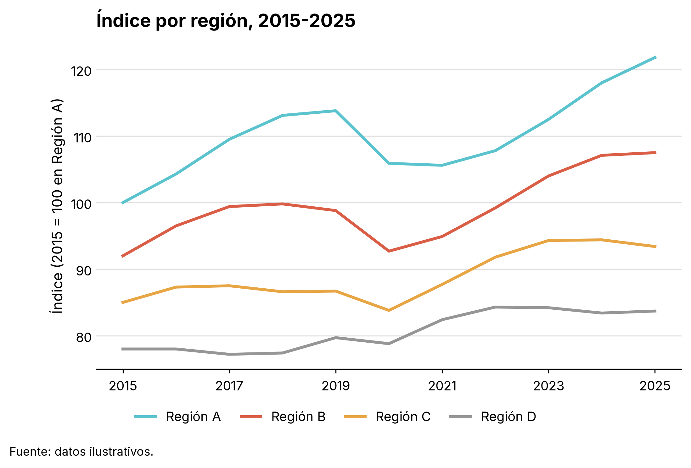
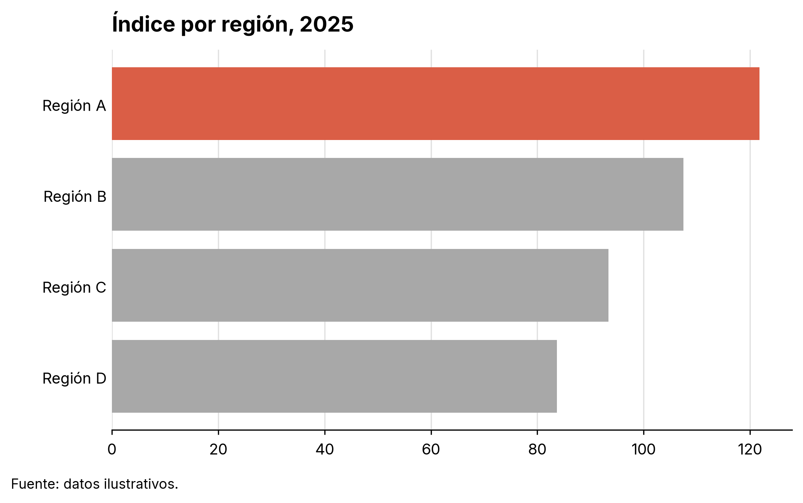
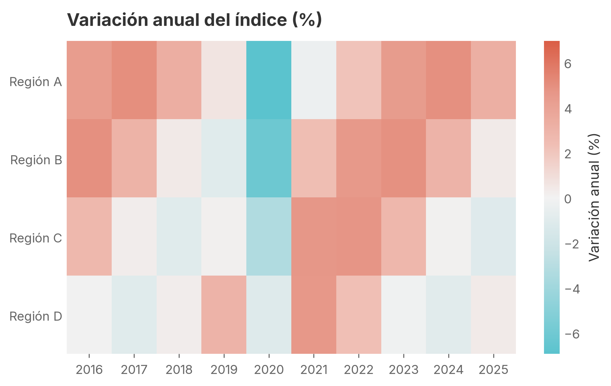

# graph-template

Formato estándar de gráficas para **Python**, **R** y **Stata**, con la misma paleta de colores y la fuente **Inter** en los tres lenguajes. El objetivo es que una gráfica se vea igual sin importar en qué programa se hizo.


## Instalación rápida

Se instala una sola vez en cada computador. Después basta una línea en cada script.

| | Instalar (una vez) | Usar en cada script |
|---|---|---|
| **Python** | `pip install git+https://github.com/fedesarrollo/graph-template` | `import estilo_graficas as eg` y `eg.aplicar_estilo()` |
| **R** | `remotes::install_github("fedesarrollo/graph-template", subdir = "R")` | `library(estilograficas)` y `aplicar_estilo()` |
| **Stata** | `net install paleta, from("https://raw.githubusercontent.com/fedesarrollo/graph-template/main/stata") replace` | `set scheme paleta` y `paleta_colores` |

Para **actualizar** (por ejemplo, si cambia un color), vuelva a correr el mismo comando de instalación. En Python agregue `--upgrade` (`pip install --upgrade git+https://...`).

> El repositorio debe ser público en GitHub para que estos comandos funcionen sin credenciales.

## Contenido

```
graph-template/
├── paleta.json              # Fuente única de los colores (referencia)
├── paleta.jpeg              # Imagen original de la paleta
├── pyproject.toml           # Hace instalable el paquete de Python
├── python/estilo_graficas/  # Paquete de Python (matplotlib / pandas / seaborn)
│   ├── __init__.py
│   └── fuentes/             # Inter incluida
├── R/                       # Paquete de R "estilograficas"
│   ├── DESCRIPTION
│   ├── NAMESPACE
│   ├── R/estilo_graficas.R  # Tema y escalas para ggplot2
│   └── inst/fuentes/        # Inter incluida
├── stata/                   # Paquete de Stata "paleta" (net install)
│   ├── stata.toc, paleta.pkg
│   ├── scheme-paleta.scheme # Scheme de Stata
│   └── paleta_colores.ado   # Comando que crea los colores como globales
└── ejemplos/
    ├── datos_ejemplo.csv    # Datos ilustrativos
    ├── ejemplo_python.py
    ├── ejemplo_r.R
    ├── ejemplo_stata.do
    └── salida/              # Gráficas generadas por los ejemplos
```

## La paleta

Hay cinco familias de color. Cada una tiene cinco tonos, del **1 (más claro)** al **5 (más intenso)**. Cuando se nombra una familia sin número (por ejemplo, "coral"), se refiere al tono 5.

| Familia    | 1         | 2         | 3         | 4         | 5         |
|------------|-----------|-----------|-----------|-----------|-----------|
| `gris`     | `#F2F2F2` | `#E0E0E0` | `#CDCDCD` | `#A8A8A8` | `#969696` |
| `ambar`    | `#F5DBB4` | `#F2D09E` | `#EDBB71` | `#EAB05A` | `#E7A544` |
| `naranja`  | `#F8D0B6` | `#F6C2A0` | `#F1A675` | `#EF985F` | `#ED8A49` |
| `coral`    | `#F0BFB5` | `#ECAC9F` | `#E79889` | `#DE715C` | `#DA5E46` |
| `turquesa` | `#E4EAEB` | `#C9E2E5` | `#92D3DA` | `#76CBD4` | `#5BC3CE` |

A partir de estas familias se definen tres paletas de uso:

- **Categórica** (para distinguir grupos): turquesa, coral, ámbar, gris, naranja, turquesa 3, coral 3, ámbar 3. Las series toman los colores en ese orden.
- **Secuencial** (para valores de menor a mayor): los cinco tonos de una sola familia.
- **Divergente** (para valores alrededor de un centro, como variaciones positivas y negativas): turquesa → gris claro → coral.

Además, el texto y los ejes van en **negro** (`#000000`) y la cuadrícula en gris claro (`#E0E0E0`).

## La fuente: Inter

Todas las gráficas usan [Inter](https://rsms.me/inter/) (licencia SIL Open Font License, que permite redistribuirla).

- **Python y R:** Inter viene **incluida en el paquete**. No hay que instalar nada más y las gráficas salen iguales en cualquier computador, en PNG y en PDF.
- **Stata:** Stata solo usa fuentes instaladas en el sistema, así que hay que **instalar Inter en el computador una vez**:
  - macOS: descargue el ZIP de [rsms.me/inter](https://rsms.me/inter/download/), abra la carpeta `extras/ttf` y haga doble clic en `Inter-Regular.ttf` y `Inter-Bold.ttf` → *Instalar*. También sirve `brew install --cask font-inter`.
  - Windows: el mismo ZIP; clic derecho sobre los `.ttf` → *Instalar para todos los usuarios*.
  - Después de instalarla, reinicie Stata.

### Reglas del formato

1. Fuente Inter. Fondo blanco, sin recuadro alrededor de la gráfica.
2. Texto y ejes en **negro**. Solo líneas de cuadrícula horizontales, en gris claro. En Python y R no se dibuja la línea del eje vertical (en Stata sí, porque un scheme no permite quitar solo esa).
3. Título en negrita, alineado a la izquierda. La leyenda va abajo, sin título.
4. La fuente de los datos va en una nota abajo a la izquierda.
5. **Máximo cuatro o cinco colores por gráfica.** Ámbar y naranja son parecidos: si hay que distinguir muchas series, conviene agruparlas, usar paneles o resaltar solo las importantes.
6. Para resaltar un dato, ponga el resto en `gris` (tono 4) y el dato destacado en `coral` o `turquesa`.
7. Exporte en PNG a 300 dpi para documentos y presentaciones, y en PDF cuando se necesite calidad vectorial.

---

## Tutorial: Python

### 1. Instalar, importar y aplicar el estilo

Instale una vez (desde la terminal, o con `!pip install ...` en un notebook). Esto instala también `matplotlib`:

```bash
pip install git+https://github.com/fedesarrollo/graph-template
```

En cada script o notebook:

```python
import matplotlib.pyplot as plt
import estilo_graficas as eg

eg.aplicar_estilo()   # todas las gráficas que se creen después usan el estilo
```

`aplicar_estilo()` usa Inter, que viene incluida en el paquete. Acepta `tamano_fuente=11` y `fuente="Inter"` (puede poner otra fuente instalada, o `None` para la de matplotlib). Los PDF guardan el texto como texto editable.

### 2. Gráfica de líneas (colores automáticos)

Las series toman los colores de la paleta categórica en orden; no hace falta indicarlos.

```python
fig, ax = plt.subplots()
for grupo, d in datos.groupby("grupo"):
    ax.plot(d["anio"], d["valor"], label=grupo)
ax.set_title("Índice por región, 2015-2025")
eg.leyenda_abajo(ax)    # leyenda abajo, fuera del área del gráfico
eg.fuente_nota(fig, "Fuente: datos ilustrativos.")   # al final, queda debajo de la leyenda
eg.guardar(fig, "mi_grafica", carpeta="salida")   # crea salida/mi_grafica.png y .pdf
```

### 3. Elegir colores a mano

```python
eg.COLORES["coral"]        # '#DA5E46' (tono 5)
eg.color("turquesa", 3)    # '#92D3DA'
eg.categorica(3)           # los 3 primeros colores categóricos
eg.secuencial("ambar", 4)  # 4 colores interpolados de la familia ámbar
eg.divergente(7)           # 7 colores de turquesa a coral
```

Ejemplo de barras con un color resaltado:

```python
colores = [eg.color("gris", 4)] * len(df)
colores[-1] = eg.COLORES["coral"]
ax.barh(df["grupo"], df["valor"], color=colores)
```

### 4. Mapas de color (heatmaps, mapas)

Al aplicar el estilo quedan registrados los colormaps `paleta_gris`, `paleta_ambar`, `paleta_naranja`, `paleta_coral`, `paleta_turquesa`, `paleta_divergente` y `paleta_categorica`:

```python
ax.imshow(tabla, cmap="paleta_divergente", vmin=-limite, vmax=limite)
# Con seaborn:  sns.heatmap(tabla, cmap="paleta_coral")
# Con geopandas: gdf.plot(column="valor", cmap="paleta_turquesa")
```

Para escalas divergentes, use límites simétricos (`vmin=-x, vmax=x`) para que el cero quede en el color central.

---

## Tutorial: R

### 1. Instalar, cargar y aplicar el estilo

Instale una vez (esto instala también `ragg` y `showtext`, que el paquete usa para respetar los colores exactos y la fuente Inter al exportar):

```r
install.packages("remotes")
remotes::install_github("fedesarrollo/graph-template", subdir = "R")
```

En cada script:

```r
library(estilograficas)   # también carga ggplot2
aplicar_estilo()          # tema y colores por defecto para toda la sesión
```

`aplicar_estilo()` fija `theme_paleta()` como tema, Inter como fuente y la paleta categórica como colores por defecto. Si prefiere no cambiar la sesión, agregue el tema y las escalas a cada gráfica:

```r
ggplot(datos, aes(anio, valor, color = grupo)) +
  geom_line() +
  scale_color_paleta() +
  theme_paleta()
```

### 2. Gráfica de líneas

```r
g <- ggplot(datos, aes(anio, valor, color = grupo)) +
  geom_line() +
  labs(title = "Índice por región, 2015-2025",
       x = NULL, y = "Índice",
       caption = "Fuente: datos ilustrativos.")

guardar_grafica(g, "mi_grafica", carpeta = "salida")   # PNG y PDF, 8 x 4.5 pulgadas
```

Use `guardar_grafica()` en lugar de `ggsave()` directamente: es la que garantiza que la fuente y los colores salgan bien. En el panel de gráficas de RStudio la fuente puede verse distinta; el archivo guardado es el que vale. Si escribe texto con `annotate()` o necesita la fuente en otro lugar, use `family = paleta_fuente`.

`guardar_grafica()` acepta `formatos`, `ancho`, `alto` (en pulgadas) y `dpi`.

### 3. Escalas disponibles

| Uso | Color (líneas, puntos) | Relleno (barras, áreas, mapas) |
|---|---|---|
| Categórica | `scale_color_paleta()` | `scale_fill_paleta()` |
| Secuencial | `scale_color_paleta_c("coral")` | `scale_fill_paleta_c("coral")` |
| Divergente | `scale_color_paleta_div(centro = 0)` | `scale_fill_paleta_div(centro = 0)` |

### 4. Elegir colores a mano

```r
paleta_colores[["coral"]]     # "#DA5E46"
paleta_color("turquesa", 3)   # "#92D3DA"
paleta_cat(3)                 # 3 primeros colores categóricos
paleta_sec(4, "ambar")        # 4 colores de la familia ámbar
paleta_div(7)                 # 7 colores de turquesa a coral
```

Barras con un color resaltado:

```r
ggplot(df, aes(valor, reorder(grupo, valor), fill = valor == max(valor))) +
  geom_col() +
  scale_fill_manual(values = c(`FALSE` = paleta_color("gris", 4),
                               `TRUE`  = paleta_colores[["coral"]]),
                    guide = "none")
```

---

## Tutorial: Stata

### 1. Instalar y activar el scheme

Instale una vez:

```stata
net install paleta, from("https://raw.githubusercontent.com/fedesarrollo/graph-template/main/stata") replace
```

Al inicio de cada do-file:

```stata
set scheme paleta
paleta_colores
```

Si quiere que el scheme quede fijo y no tener que escribir `set scheme` cada vez, corra una sola vez `set scheme paleta, permanently`.

`paleta_colores` además fija Inter como fuente de las gráficas (requiere Inter instalada, ver [La fuente: Inter](#la-fuente-inter)). Este ajuste queda guardado en Stata, no hay que repetirlo en cada sesión, aunque no hace daño hacerlo.

Con el scheme activo, todas las gráficas usan el fondo blanco, la cuadrícula horizontal y los colores de la paleta categórica en orden (`p1` = turquesa, `p2` = coral, `p3` = ámbar, ...).

### 2. Usar los colores por nombre

El comando `paleta_colores` también crea globales con cada color en formato RGB:

```stata
paleta_colores

* $coral, $turquesa, $ambar, $naranja, $gris   -> tono 5
* $coral1 ... $coral5                          -> tonos de cada familia
* $cat1 ... $cat8                              -> paleta categórica
* $div1 ... $div7                              -> paleta divergente
```

Se usan dentro de `color()`, entre comillas:

```stata
twoway (line valor anio if grupo == "Región A", lcolor("$turquesa")) ///
       (line valor anio if grupo == "Región B", lcolor("$coral")), ///
    title("Índice por región", position(11) span) ///
    note("Fuente: datos ilustrativos.", span)
graph export "salida/mi_grafica.png", replace width(2400)
```

Consejos:

- `title(..., position(11) span)` alinea el título a la izquierda, como en Python y R.
- `graph export ..., width(2400)` da una resolución equivalente a 300 dpi para una gráfica de 8 pulgadas.
- Para mapas de calor o mapas, `heatplot` y `spmap` aceptan los globales en `colors()`. Por ejemplo, `colors("$div1" "$div2" "$div3" "$div4" "$div5" "$div6" "$div7", ipolate(21))` (requiere `ssc install heatplot`, `palettes` y `colrspace`).

---

## Ejemplos

Cada script produce las mismas tres gráficas (líneas, barras con un dato resaltado y mapa de calor divergente) a partir de `ejemplos/datos_ejemplo.csv`. Requieren el paquete instalado (ver arriba); el de Python requiere además `pandas`. Ejecútelos desde la raíz del repositorio:

```bash
python ejemplos/ejemplo_python.py
Rscript ejemplos/ejemplo_r.R
```

```stata
cd "ruta/a/graph-template"
do ejemplos/ejemplo_stata.do
```

| Python | R |
|---|---|
|  |  |
|  |  |
|  |  |

## Cambiar o agregar colores

`paleta.json` es la referencia. Si un color cambia, actualícelo en `paleta.json`, `python/estilo_graficas/__init__.py`, `R/R/estilo_graficas.R`, `stata/scheme-paleta.scheme` y `stata/paleta_colores.ado` (en Stata los colores van en RGB, por ejemplo `#DA5E46` → `"218 94 70"`).

Luego suba la versión en `pyproject.toml` y `R/DESCRIPTION`, cambie `Distribution-Date` en `stata/paleta.pkg`, y pida a los usuarios que vuelvan a correr el comando de instalación.
